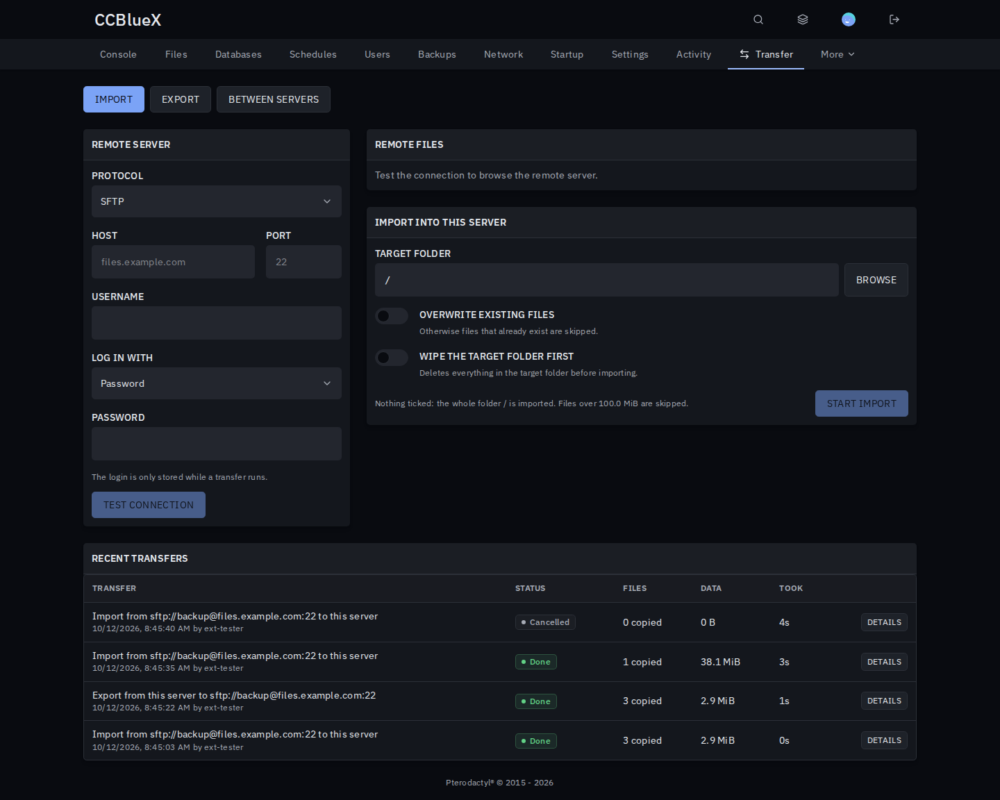
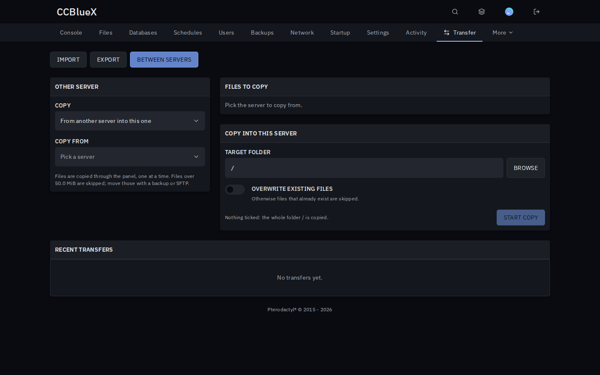

# File Transfer for Pterodactyl

Move a server from another host over SFTP or FTP, back files up to your own storage, or copy files between your servers.

## Install

1. Download `file-transfer-<version>.pteroext` from the [latest release](https://github.com/CCBlueX/Pterodactyl-Extension-File-Transfer/releases/latest).
2. Install and enable it under **Admin → Extensions**.
3. Open a server's **Transfer** tab, or click **Transfer** next to **New folder** in the file manager. Tick files there and click **Export** to send just those.

## Features

- **Import**: log in to an SFTP, FTP or FTPS server, browse it, tick files or take a whole folder. Optionally wipe the target folder first, with an archive of the old files.
- **Export**: send files or folders to an SFTP or FTP server, one by one or as a single archive.
- **Between servers**: copy files to or from any server you can manage files on, on the same or another node.
- **Runs in the background**: live progress, cancel at any time, and a history with every failed or skipped file.
- **Safe**: logins are only stored, encrypted, while a transfer runs. Private and local addresses are blocked, and paths cannot leave the server.

## Settings

| Setting | Default | What it does |
| --- | --- | --- |
| Import, Export, Copy between servers | On | Turns each feature on or off. |
| Allowed protocols | SFTP, FTP, FTPS | Which remote servers users can connect to. |
| Largest file for imports and exports | 100 MiB | Bigger files are skipped. |
| Largest file for copies between servers | 50 MiB | Bigger files are skipped; move those with a backup. |
| Connection timeout | 10 seconds | How long to wait for a remote server. |
| Allow private and local hosts | Off | Lets users connect to private networks and localhost. |

Subusers get a **File Transfer** group in the server's **Users** tab: import, export and copy. Each also needs the matching file permissions.

---

Inspired by the Pterodactyl marketplace extensions Server Importer and File Transfer.
